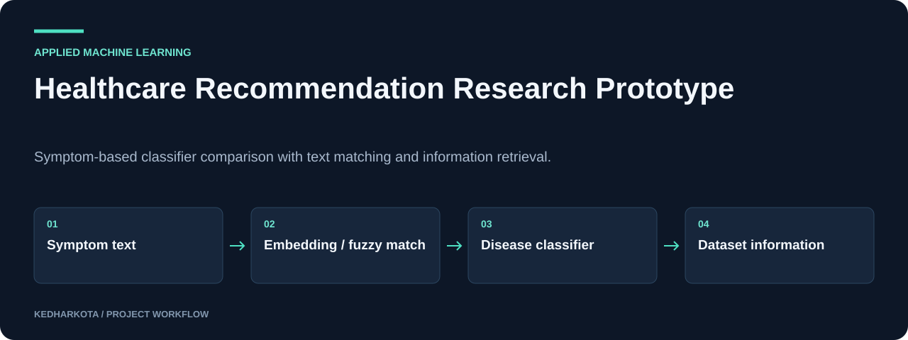

# Healthcare Recommendation Research Prototype

Symptom-based classifier comparison with text matching and information retrieval.

**Python · scikit-learn · XGBoost · Sentence Transformers · GPT-2**

[](https://github.com/kedharkota/Healthcare-Recommendation-System/actions/workflows/docs.yml)

[Overview](#overview) · [Getting started](#getting-started) · [Repository guide](#repository-guide) · [Reproducibility](docs/REPRODUCIBILITY.md)

<p align="center">
  
</p>

[Open full-size visual](docs/assets/overview.svg)

*Explanatory workflow diagram based on the committed project materials.*

## Project at a glance

| Detail | Project information |
| --- | --- |
| **Focus** | Symptom-classifier comparison and text matching |
| **Start here** | [ML.ipynb](ML.ipynb) |
| **Run mode** | Jupyter research prototype; external CSVs and code completion needed |
| **Explore** | Model-comparison code, matching routines, and information lookup |

## Overview

A notebook experiment comparing disease-label classifiers built from symptom features, then connecting free-text symptom matching to dataset-backed disease information. The workflow explores traditional classifiers, sentence embeddings, fuzzy matching, and a GPT-2 narrative step.

## What this project includes

- Random Forest, logistic regression, XGBoost, and MLP classifier comparison.
- Grid-search tuning, test accuracy, weighted F1, and classification reports.
- MiniLM symptom embeddings with text correction and fuzzy matching.
- Lookup of descriptions, diet, precautions, medication, and exercise fields from reference tables.

## Getting started

Open `ML.ipynb` in Jupyter and review its installation and data-loading cells. The notebook mixes a Colab Drive mount with local Windows paths, so choose one environment and remove or skip cells that do not apply.

Provide the required CSVs, replace their paths, and install compatible versions of the imported libraries: pandas, NumPy, Matplotlib, scikit-learn, XGBoost, Transformers, sentence-transformers, fuzzywuzzy, python-Levenshtein, TextBlob, and pyspellchecker.

### Required inputs and current constraints

The notebook expects `Training.csv`, `description.csv`, `diets.csv`, `medications.csv`, `precautions_df.csv`, `Symptom-severity.csv`, `symtoms_df.csv`, and `workout_df.csv`. These are not committed. The embedding matcher contains an empty `np.argmax()` call that must be completed before the text-input branch can run end to end.

## Repository guide

| File | Purpose |
| --- | --- |
| [ML.ipynb](ML.ipynb) | Data loading, model comparison, symptom matching, and text-generation prototype. |
| [ML_PPT.pdf](ML_PPT.pdf) | Project presentation. |

## Results and project status

The notebook includes classifier-evaluation code, but this README does not claim a verified benchmark. Model selection currently uses the test-set scores; reserve a separate final evaluation set before reporting generalization. The output is an experimental association with dataset labels, with no clinical diagnostic validation established.

## Next steps

- Fix the symptom-matching call and make dataset paths portable.
- Separate model selection from final evaluation and document source-data provenance.

## Documentation maintenance

<details>
<summary>Run documentation checks and maintain visuals</summary>

Local documentation links and image headers are checked on pull requests and relevant pushes by the [documentation workflow](.github/workflows/docs.yml). Run the same check locally:

```bash
python tools/check_docs.py
```

See the [reproducibility guide](docs/REPRODUCIBILITY.md) for evidence, missing artifacts, and visual-source notes. The check validates documentation files; it does not train models or certify application behavior.

</details>

## Explore related projects

- [Cross-Lingual Sentiment Analysis](https://github.com/kedharkota/cross-lingual-sentiment-analysis)
- [Cardiac Ultrasound Segmentation](https://github.com/kedharkota/-Heart-Murmur-)

---

[More projects by kedharkota](https://github.com/kedharkota?tab=repositories)
